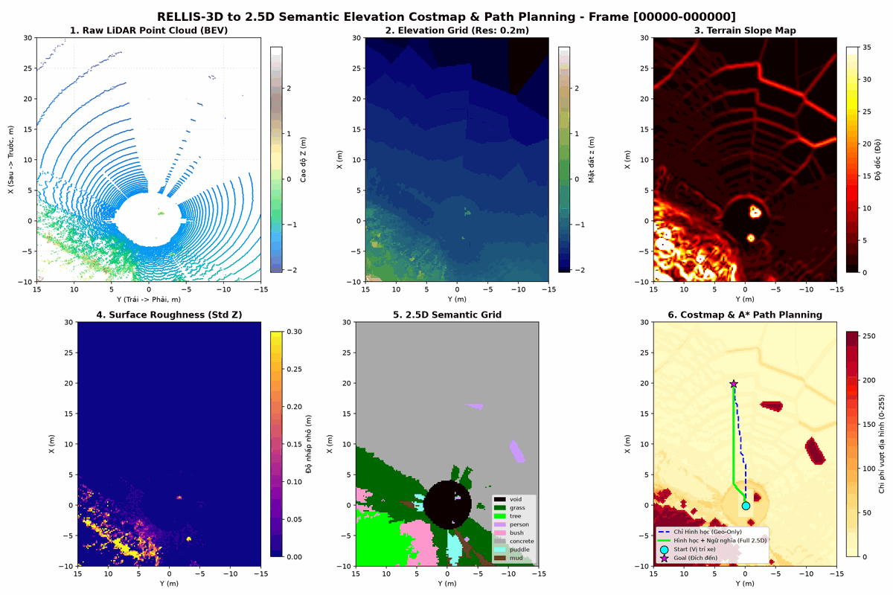
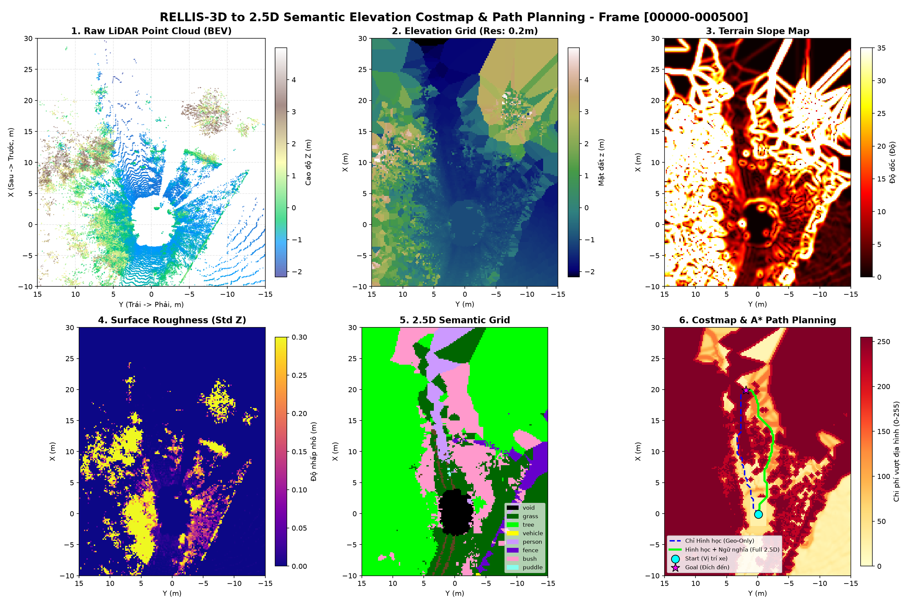

# RELLIS-3D to 2.5D Semantic Elevation Costmap & Path Planning Benchmark

Dự án nghiên cứu và xây dựng bộ dữ liệu **2.5D Semantic Elevation Costmap** từ tập dữ liệu off-road thực tế **RELLIS-3D** phục vụ bài toán quy hoạch quỹ đạo và tự hành xe bánh xích/bánh lốp (UGV).

---

## 🎬 1. Demo Trực Quan Hóa Quỹ Đạo Thời Gian Thực



*Xe tự động thích ứng với địa hình off-road: né tránh hố bùn và bụi cây rậm, bám sát hành lang an toàn (xanh lá cây).*

---

## 📌 2. Kết Quả Nghiệm Thu Đạt Được

- **Quy mô dữ liệu đã sinh:** **13,556 frames** dữ liệu chuẩn `.npz` nén trên 5 Sequence (`00000` đến `00004`).
- **Dung lượng tổng thể:** ~3.26 GB.
- **Trực quan hóa:** **275 ảnh Dashboard** chi tiết 6 góc nhìn (Raw LiDAR, Elevation, Slope, Roughness, Semantic Grid, Costmap & A* Path).
- **Thực nghiệm A* Planning:**
  - Tỉ lệ thành công: **100%**.
  - Mức giảm thiểu rủi ro địa hình so với chỉ dùng độ cao hình học: **29.24%**.
  - Né tránh được hơn **9,000 điểm rủi ro cao** (hố bùn, bụi rậm, đá lổn nhổn).

---

## 📊 3. Dashboard Mẫu (6 Góc Nhìn)



---

## 📁 4. Cấu Trúc Mã Nguồn

```text
├── README.md                 # Tài liệu tổng quan dự án
├── process_rellis_25d.py     # Pipeline xử lý 3 giai đoạn cốt lõi
├── run_batch_2_3_4.py        # Script batch runner xử lý hàng loạt sequence đa luồng
├── evaluate_metrics.py       # Script tính toán các chỉ số định lượng đánh giá thuật toán
├── demo_load_dataset.py      # Script Python mẫu hướng dẫn load và truy xuất file .npz
├── create_animation_gif.py   # Script tạo ảnh động demo từ các ảnh preview
├── demo_sequence_00000.gif   # Clip ảnh động demo xe chạy thời gian thực cho Slide
├── demo_quickview.png        # Ảnh kết quả demo nhanh 4 kênh
└── samples/                  # Thư mục chứa dữ liệu .npz mẫu và dashboard các sequence
    ├── 00000_000500_25d_dataset.npz
    ├── dashboard_seq00000.png
    ├── dashboard_seq00001.png
    ├── dashboard_seq00002.png
    ├── dashboard_seq00003.png
    └── dashboard_seq00004.png
```

---

## 🚀 5. Hướng Dẫn Sử Dụng Nhanh

### 5.1. Cài đặt môi trường
```bash
pip install numpy scipy matplotlib pillow
```

### 5.2. Đọc và sử dụng file dữ liệu 2.5D (.npz)
```bash
python demo_load_dataset.py
```
Mỗi file `.npz` bao gồm:
* `elevation`: Ma trận độ cao mặt đất $(200 \times 150)$ (mét).
* `slope`: Ma trận độ dốc địa hình (radian).
* `roughness`: Độ gồ ghề bề mặt địa hình ($\sigma_z$).
* `step_height`: Bước chênh độ cao thẳng đứng giữa các ô lân cận.
* `semantic`: Ma trận nhãn lớp vật thể/địa hình.
* `costmap`: Ma trận chi phí di chuyển tích hợp ($0 \to 255$).
* `costmap_geom`: Ma trận chi phí chỉ dựa trên hình học.
* `path_semantic` & `path_geom`: Tọa độ đường đi tìm được bằng thuật toán A*.

### 5.3. Chạy tái hiện tính toán các chỉ số định lượng:
```bash
python evaluate_metrics.py
```

### 5.4. Xử lý thêm một Sequence mới bất kỳ:
```bash
python process_rellis_25d.py --seq 00005 --all --workers 8 --preview_every 50 --out out_00005
```
